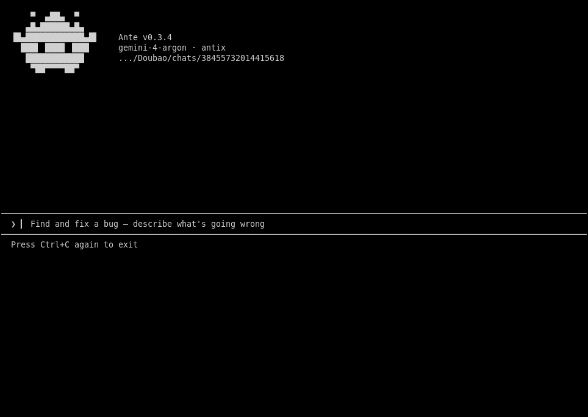
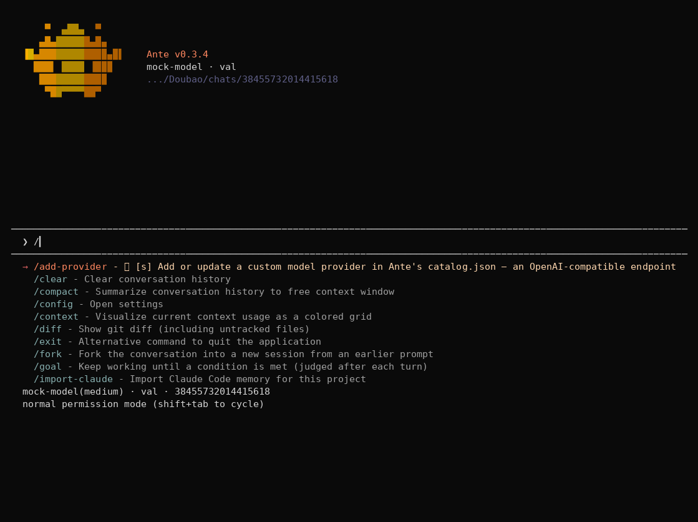

# ante-rs

> **仅供学习与研究（FOR STUDY / RESEARCH ONLY）**
>
> 本项目是对 Antigma Labs 的 `ante` 0.3.4 进行的独立逆向学习与 Rust 重实现，用于研究终端 AI Agent 的协议、TUI 渲染与权限模型，**不得用于商业用途、不得用于绕过任何授权或付费机制**。
> 项目不包含原始二进制、原始内嵌手册或任何受版权保护的资源文件；"Ante" 及相关名称、商标归 Antigma Labs 所有。
> 若权利人认为本项目侵犯其权益，请提交 Issue，我们将在核实后立即删除相关内容。使用本项目产生的一切后果由使用者自行承担。
>
> **This is an independent reverse-engineering study. Not affiliated with or endorsed by Antigma Labs. No original binaries or proprietary assets are included. For study only; no warranty; no commercial use.**

`ante` 0.3.4（Antigma Labs 终端 AI 编码代理）的 Rust 等效替代实现，仅依赖公开 crates，
不包含原二进制代码。逆向过程与验证结论见 [REVERSE_ENGINEERING.md](REVERSE_ENGINEERING.md)。

## 构建

```bash
cargo build --release
# 产物：target/release/ante
```

要求 Rust 1.80+（`async` 递归、`let-else` 等），无系统库依赖。

## 使用

```bash
# 非交互执行
ante -p "解释这个仓库的入口" --output-format json

# 指定 provider / 模型
ante --provider mock -m mock-model -p "hi"

# 交互式 REPL
ante

# 协议服务（JSONL over stdio）
ante serve --stdio

# 其它子命令
ante auth list / add <name> / rm <name>
ante catalog
ante doctor
ante usage
ante rage

# 离线模式（钉死 llama.cpp b12182）
ante offline install                 # 按平台/GPU 选包、校验 SHA-256、解压、自检、原子安装
ante offline status                  # 引擎、模型目录、默认模型、router 状态
ante offline list                    # 本地 GGUF + verified 模型
ante offline use <model> --context 8192
ante --offline-model <GGUF|名称|URL> -p "hi"
ante offline stop                    # 按进程组停止 router
```

离线安装会优先读取 `LLAMA_CACHE` 与 `ANTE_LLAMA_ARTIFACT`（本地包），下载源可用
`ANTE_LLAMA_CPP_BASE_URL` 或 `ANTE_LLAMA_CPP_ARTIFACT_URL` 覆盖；正常安装不接受未校验产物。

常用参数：`--effort`、`--yolo`、`--permission-mode`、`--system-prompt(-file)`、
`--append-system-prompt`、`--short-prompt`、`--skills/--no-skills`、
`--tools/--include-tools/--exclude-tools`、`--session-save/--no-session-save`、
`--profile`、`-r/--resume`。

## 配置

- Home：`$ANTE_HOME` 或 `~/.ante`
- `settings.json` 支持 `provider`、`model`、`permission_mode`、`permissions`、`tools` 等键
- `catalog.json` 的 `providers` 为以 id 为键的对象，可覆盖内嵌目录或新增 provider
- 项目层 `.ante/settings.json` 只影响会话，不能放宽权限
- 凭据：`auth/credentials/secret/<name>.json`
- 会话：`sessions/ses_<ULID>/`

### 自定义 provider 示例

```json
{
  "providers": {
    "local": {
      "display_name": "Local",
      "base_url": "http://127.0.0.1:11434/v1",
      "wire_style": "OpenAiCompatible",
      "credential": "env:LOCAL_API_KEY",
      "preferred_models": [
        { "id": "qwen", "description": "local", "context_limit": 32768,
          "max_tokens": 4096, "effort": "medium", "support_vision": false }
      ]
    }
  }
}
```

`wire_style` 取值：`OpenAiCompatible`、`OpenAiResponse`、`AnthropicMessage`、`Gemini`。

## 目录结构

```
src/
  main.rs cli.rs runtime.rs        CLI 与运行时
  catalog.rs settings.rs credentials.rs
  client.rs llm.rs wire/           HTTP/SSE 与四种协议
  agent.rs tools/                 turn 循环与工具
  session.rs protocol.rs headless.rs repl.rs
  commands/                       auth doctor usage rage offline update serve
resources/                        内嵌 catalog、工具 schema、提示词分段、内置 skills/agents
```

## 限制

- 远程 `auth add` 校验以 `GET /models` 近似，未复刻原件的私有校验端点
- 未逐帧复刻全屏 TUI，提供等价 REPL
- 离线模式已实现引擎安装、router 生命周期与本地推理；MCP、自动更新为基本流程实现

## 逐帧一致性测试

`tests/frame_test.py` 在 120x40 PTY 中分别运行原件与重写版，用 pyte 还原字符网格后逐字符比对，当前 9/9 全部通过：

- welcome-frame（1.000，跳过第 4 行动画字标）
- composer、footer-hint、command-palette
- palette-frame（`/` 面板整块，1.000；更新提示随面板上移，底对齐分隔线）
- overlay-theme / overlay-providers / overlay-models（1.000）

黄金帧位于 `tests/golden/orig_*_120x40.txt`，原件可执行放在 `work/ante/ante` 时可直接重跑。

更新提示（`* Update available: v0.3.7` + 变更日志摘要 + `/update` 提示）由 `update_notice()` 真实读取 `ANTE_HOME/versions.json`，按 111 列词换行渲染：跳过 `## 标题` 与空行，`### 标题` 走 `└─` 前缀，正文缩进 7 列；内容超过 8 行时输出 `… N more at https://ante.run/changelog`，`dismissed_version` 等于最新版时不再显示。

## 文档对齐

`DOC_CONFORMANCE.md` 记录 5 篇官方 usage 文档与本实现的逐项状态。`tests/docs_conformance_test.py` 覆盖 `oauth_profiles` / `helpers` 校验与 helper 执行语义，`tests/frame_test.py` 会自动重建 `/tmp/ah_tui` 抓帧环境。

## 视觉验证

TUI 在真实 GUI 终端（xterm 372 + Xvfb，120×40）中的渲染截图：





逐帧字符级一致性由 `tests/frame_test.py` 对原件黄金帧比对（9/9，相似度 1.000）。
